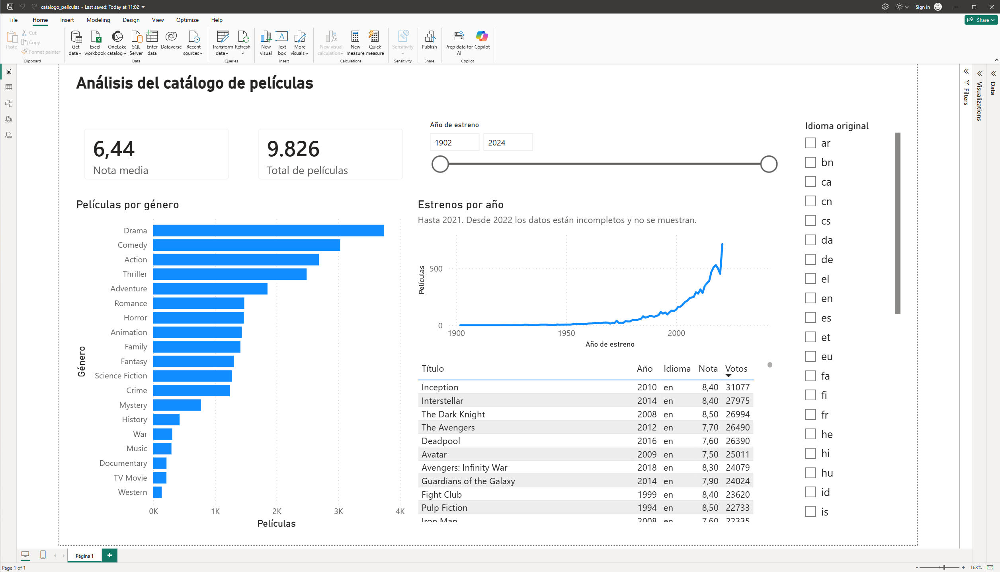
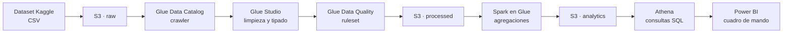

# Pipeline de datos batch en AWS: catálogo de películas

Pipeline de datos en AWS ingiere, valida, transforma y explota un catálogo de **9.826 películas (1902–2024)**, y termina en un cuadro de mando de Power BI con KPIs y filtros por año e idioma.

Proyecto final del módulo de Big Data de la Especialización en Big Data e Inteligencia Artificial (Universidad Alfonso X el Sabio, 2026).



##Objetivo

Construir una arquitectura de datos completa y trazable sobre AWS, desde el dato bruto hasta el informe final, aplicando control de calidad antes de que los datos lleguen a la visualización. El caso de uso responde a preguntas como:

- ¿Cómo ha evolucionado el número de películas estrenadas por año?
- ¿Qué géneros concentran más títulos y cuáles están mejor valorados?
- ¿Cómo se reparte el catálogo por idioma original?

## Arquitectura



| Etapa | Servicio | Qué hace |
| --- | --- | --- |
| Almacenamiento | Amazon S3 | Zonas separadas: `raw/` (dato original), `processed/` (dato limpio y validado) y `analytics/` (tablas para explotación) |
| Catalogación | AWS Glue Data Catalog | Crawler que detecta el esquema y registra las tablas |
| Transformación | AWS Glue Studio | Selección de columnas, conversión de tipos y normalización |
| Calidad de datos | AWS Glue Data Quality | Validación de las reglas de calidad antes de la explotación |
| Procesamiento | Apache Spark (Glue) | Agregaciones y preparación de tablas analíticas |
| Consulta | Amazon Athena | Tablas externas sobre S3 y consultas SQL de explotación |
| Visualización | Power BI | KPIs, evolución temporal, distribución por género y tabla de detalle |

Elegí la **ruta batch** porque el catálogo es un histórico que se carga y procesa por lotes; no hay eventos en tiempo real que justifiquen una arquitectura streaming.

## Datos

Los datos de `data/` son la salida de las dos consultas de Athena que alimentan el cuadro de mando:

| Archivo | Filas | Contenido |
| --- | --- | --- |
| `csv_query_4_es.csv` | 9.826 | Una fila por película: año y fecha de estreno, título, popularidad, número de votos, nota media, idioma original y géneros |
| `csv_query_3_es.csv` | 19 | Una fila por género: número de películas y nota media |

Una película puede tener varios géneros (por ejemplo, `Drama, Romance`), así que la tabla por géneros suma más títulos que el catálogo.

Ejemplo de consulta equivalente a la tabla por géneros (reconstruida para este repositorio):

```sql
SELECT trim(g)                     AS genero,
       count(*)                    AS peliculas,
       round(avg(vote_average), 2) AS nota_media
FROM peliculas
CROSS JOIN UNNEST(split(genre, ',')) AS t(g)
GROUP BY trim(g)
ORDER BY peliculas DESC;
```

## Cuadro de mando

- **KPIs:** nota media del catálogo y total de películas.
- **Evolución temporal:** películas por año de estreno, hasta 2021. Los años siguientes están incompletos en el dataset (208 películas en 2022, 8 en 2023 y 1 en 2024), así que se excluyen para no mostrar una caída falsa.
- **Distribución por categoría:** películas por género.
- **Detalle:** tabla con título, año, idioma, nota, votos y popularidad.
- **Filtros:** año de estreno e idioma original.

### Conclusiones

1. El catálogo se concentra en cine reciente: 2010–2019 aporta 3.998 títulos, el 41 % del total.
2. Está dominado por películas en inglés (7.569, el 77 %), seguidas de japonés (645) y español (339).
3. Drama, Comedia y Acción son los géneros con más títulos, pero los mejor valorados son géneros minoritarios como Historia (6,97) y Bélico (6,95).

## Análisis posterior y mejora propuesta

Al revisar los datos después de entregar el proyecto encontré dos problemas de calidad que el cuadro de mando no tenía en cuenta:

- **100 películas tienen nota 0.** Lo más probable es que signifique "sin valoraciones" y no una nota real, porque una media de exactamente 0 sobre 10 es prácticamente imposible. Al incluirlas, la nota media baja de 6,51 a 6,44.
- **360 películas tienen menos de 10 votos**, así que su nota media es poco representativa.

Mejora propuesta: añadir al ruleset de Glue Data Quality una regla que marque las películas sin votos (`vote_count > 0`) y calcular la nota media solo sobre títulos con un mínimo de votos.

## Lecciones aprendidas

- **Revisar la agregación de cada visual.** La primera versión del cuadro de mando sumaba la nota media en lugar de promediarla, y también sumaba el año de estreno en la tabla. Lo corregí a "Promedio" y "No resumir".
- **Revisar el modelo de datos.** Las dos tablas no estaban relacionadas, así que los filtros no afectaban a todos los visuales.
- **Guardar los datos fuera del laboratorio.** El entorno de AWS se reinició al terminar el curso. Los datos se recuperaron porque Power BI, en modo importación, guarda una copia dentro del archivo `.pbix`.

## Estructura del repositorio

```
aws-batch-pipeline-peliculas/
├── README.md
├── catalogo_peliculas.pbix     # Cuadro de mando de Power BI
├── data/
│   ├── csv_query_4_es.csv      # Detalle de películas (salida de Athena)
│   └── csv_query_3_es.csv      # Resumen por género (salida de Athena)
└── docs/
    └── dashboard.png           # Captura del cuadro de mando
```

## Cómo abrirlo

1. Descarga el repositorio.
2. Abre `catalogo_peliculas.pbix` con Power BI Desktop.
3. Si quieres refrescar los datos, en **Transformar datos** cambia la ruta del paso **Origen** de cada consulta a la carpeta `data/` de tu equipo.

## Tecnologías

Amazon S3 · AWS Glue (Data Catalog, Studio, Data Quality) · Apache Spark · Amazon Athena · SQL · Power BI

## Autor

**Enrique David Ríos González** · [LinkedIn](https://www.linkedin.com/in/enrique-rios-1861663a7)
